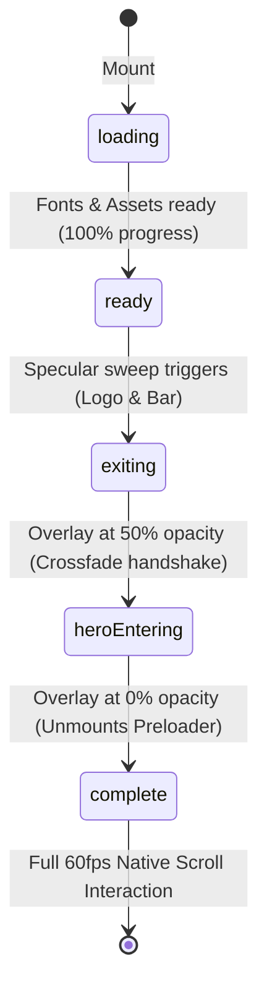

# URBO V5.4 — ESPECIFICACIÓN DE MOVIMIENTO Y LIQUID GLASS
## MotionSites Motion Tokens & Optical Material Spec

---

## 1. Tokens de Movimiento Unificados

```ts
export const motion = {
  duration: {
    micro: 0.18,      // Micro-interacciones, toggles, badges (180ms)
    fast: 0.32,       // Botones, transiciones de pestañas, tabs (320ms)
    normal: 0.55,     // Encabezados de sección, tarjetas de grid, sheens (550ms)
    reveal: 0.75,     // Revelación del Hero, cockpits y mapas (750ms)
  },
  ease: {
    enter: 'power3.out',        // Entrada física con desaceleración natural
    exit: 'power2.inOut',       // Disolución suave y crossfade
    transition: 'power2.inOut', // Cambios simétricos de estado
    subtle: 'power2.out',       // Micro-parallax, tilt pasivo y tracking
  },
  distance: {
    micro: 8,
    sm: 16,
    md: 20,
    lg: 24,
  },
} as const;
```

---

## 2. Receta Oficial Liquid Glass (MotionSites Recipe #1)

Se implementó el sistema de borde de lente por degradado con máscara de exclusión:

```css
.ms-liquid-glass {
  position: relative;
  overflow: hidden;
  border: none !important;
  background: rgba(11, 20, 38, 0.55);
  background-blend-mode: luminosity;
  -webkit-backdrop-filter: blur(16px);
  backdrop-filter: blur(16px);
  box-shadow: 
    inset 0 1px 1px 0 rgba(255, 255, 255, 0.15),
    0 20px 45px -12px rgba(0, 0, 0, 0.7);
}

.ms-liquid-glass::before {
  content: "";
  position: absolute;
  inset: 0;
  border-radius: inherit;
  padding: 1.4px;
  pointer-events: none;
  background: linear-gradient(180deg,
    rgba(0, 229, 190, var(--rim-a, 0.55)) 0%,
    rgba(255, 255, 255, var(--rim-b, 0.25)) 20%,
    rgba(255, 255, 255, 0) 40%,
    rgba(255, 255, 255, 0) 60%,
    rgba(255, 255, 255, var(--rim-b, 0.15)) 80%,
    rgba(0, 229, 190, var(--rim-a, 0.45)) 100%
  );
  -webkit-mask: linear-gradient(#fff 0 0) content-box, linear-gradient(#fff 0 0);
  -webkit-mask-composite: xor;
  mask: linear-gradient(#fff 0 0) content-box, linear-gradient(#fff 0 0);
  mask-composite: exclude;
}
```

### Grados de Material
1. **Tier Protagónico (`.ms-liquid-glass--strong`)**: Navbar flotante, Cápsula del Preloader, Cockpit del Hero, Cockpit del Roadmap y Business Card de Contacto. Blur de 24px, rim aumentado (`--rim-a: 0.85; --rim-b: 0.4;`).
2. **Tier Secundario (`.ms-liquid-glass`)**: Tarjetas de diagnóstico, testimonio de Don Mauricio, feeds comunitarios y métricas. Blur de 16px, rim contenido.
3. **Botón Cromado con Brillo Especular (`.ms-btn-chrome`)**: Relleno degradado `#00E5BE` a `#008F77`, halo luminoso perimetral y haz de luz oblicuo a 115° que barre la superficie en hover (`translateX(-140% -> 140%)`).

---

## 3. Orquestador de Estados de la Máquina de Animación


