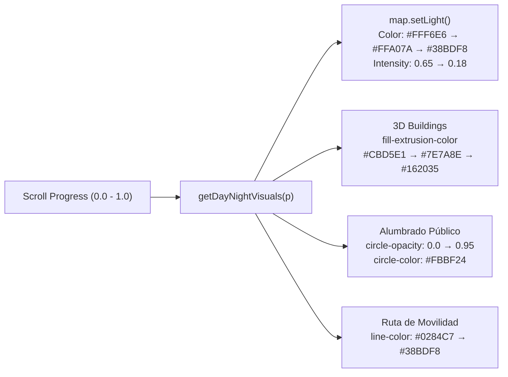

# URBO — Living City Experience & Day-to-Night 3D
## Diseño Visual, Transición Temporal e Iluminación Dinámica

---

### 1. Concepto Visual y Dirección Artística

El Hero 3D evoluciona de una demostración cartográfica oscura a una **experiencia de ciudad viva** que acompaña el avance del micro a lo largo del día:

- **Inicio en la Catedral (Día · 14:30)**: Luz solar clara, cielo slate suave, plazas arboladas legibles, edificios en tono piedra caliza arquitectónica y peatones caminando.
- **Avenida Monseñor Rivero (Tarde · 17:15)**: Iluminación cálida dorada (Golden Hour), sombras estiradas, árboles del camellón central contrastados.
- **Monumento Cristo Redentor (Atardecer · 18:45)**: Tonos índigo y violeta, cielo en transición crepuscular y encendido progresivo de las farolas de alumbrado público.
- **Corredor Norte y Cuarto Anillo (Noche · 20:30)**: Estética nocturna profunda (`#070B14`), farolas activas con aura ámbar cálida, ruta en Cyan URBO (`#38BDF8`) con borde esmeralda luminiscente y baliza GPS protagonista.

---

### 2. Implementación de la Transición Día a Noche en MapLibre GL JS

Para evitar la recarga de estilos de MapLibre (que provocaría parpadeos en blanco o pérdida de capas en tiempo de ejecución), la transición se implementa mediante **interpolación paramétrica en tiempo real sin recargar tiles**:

#### Parámetros Normalizados de Iluminación

| Franja | Progreso $p$ | Etiqueta | Color Edificios | Luz MapLibre | Intensidad | Opacidad Farolas |
| :--- | :--- | :--- | :--- | :--- | :--- | :--- |
| **Día** | `0.00 - 0.25` | `DÍA · 14:30` | `#CBD5E1` | `#FFF6E6` | `0.65` | `0.00` (Apagadas) |
| **Tarde** | `0.25 - 0.55` | `TARDE · 17:15` | `#B0BEC5` → `#7E7A8E` | `#FFD199` | `0.52` | `0.35` (Filamento cálido) |
| **Atardecer** | `0.55 - 0.78` | `ATARDECER · 18:45` | `#7E7A8E` → `#3D3852` | `#FF8C69` | `0.38` | `0.85` (Encendido activo) |
| **Noche** | `0.78 - 1.00` | `NOCHE · 20:30` | `#162035` | `#38BDF8` | `0.20` | `1.00` (Pleno brillo ámbar) |

---

### 3. Elementos Ambientales de Ciudad Viva

1. **Vegetación Urbana (`urban-greenery-source`)**:
   - Polígonos de áreas verdes reales de OpenStreetMap para la **Plaza 24 de Septiembre**, la **Plaza del Estudiante** y la rotonda ajardinada del **Cristo Redentor**.
   - Línea continua para el icónico camellón central arbolado de la **Avenida Monseñor Rivero** (`#10B981` con difuminado suave).
2. **Alumbrado Público (`street-lamps-source`)**:
   - 44 puntos georreferenciados en aceras este y oeste a lo largo de Monseñor Rivero y en el anillo circular del Cristo Redentor.
   - Capa doble: núcleo pinpoint blanco cálido (`#FFFBEB`) y aura difusa de 7px ámbar (`#FBBF24`).
3. **Vida Peatonal Estilizada**:
   - 9 peatones animados mediante microciclos paramétricos confinados estrictamente a las aceras y plazas, sin invadir la calzada vehicular.

---

### 4. Estructura Narrativa en 5 Capítulos

- **Capítulo 1 (0% - 18%)**: *Catedral Metropolitana · Plaza 24 de Septiembre*. Introducción a URBO y el problema de esperar a ciegas 35 minutos al día.
- **Capítulo 2 (18% - 38%)**: *Plaza del Estudiante · 1er Anillo*. Experiencia del pasajero, consulta sin descargas pesadas y reducción de incertidumbre.
- **Capítulo 3 (38% - 60%)**: *Monumento Cristo Redentor · 2do Anillo*. Colaboración con los choferes, avisos por voz a 300m y función Esperar Aquí.
- **Capítulo 4 (60% - 82%)**: *Corredor Norte · 3er Anillo*. Evidencia validada del piloto: 5 meses, 140 usuarios, 1.239 mensajes, 83 remitentes activos en la Línea 30.
- **Capítulo 5 (82% - 100%)**: *Visión de URBO · Viaducto Cuarto Anillo*. Escalabilidad a toda Bolivia y botones directos de acción hacia producto y contacto.
