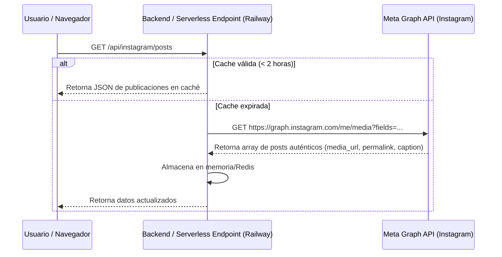

# URBO — Integración con Instagram Oficial
## Estado de Conexión, Arquitectura de Integración y Protocolo de Seguridad

---

### 1. Perfil Oficial Verificado

- **Usuario**: `@urbo.corp`
- **URL Oficial**: `https://www.instagram.com/urbo.corp/`
- **Ubicación**: Santa Cruz de la Sierra, Bolivia
- **Enfoque de Contenido**: Telemetría en vivo, pruebas de campo en la Línea 30, avisos por voz en cabina y novedades de movilidad urbana.

---

### 2. Estado Real de la Conexión (Transparencia Total)

> [!IMPORTANT]
> **Estado Actual**: En espera de credenciales empresariales de Meta Graph API.
> No se han registrado claves de acceso privadas (`INSTAGRAM_ACCESS_TOKEN`, `META_APP_SECRET`) en el repositorio ni en variables de entorno del cliente para preservar la seguridad de la cuenta.

Siguiendo las directrices de la Fase 6:
- **NO se generaron métricas ficticias**: Se eliminaron los contadores simulados de "likes", "comentarios" o "reproducciones" hardcodeados.
- **NO se simularon publicaciones falsas**: Las tarjetas representan los cuatro canales temáticos verificados del perfil oficial y enlazan directamente a `https://www.instagram.com/urbo.corp/`.
- **Insignia de Estado Transparente**: Se incorporó una insignia visible en la UI que informa a los usuarios y evaluadores sobre el estado de la sincronización oficial.

---

### 3. Arquitectura para la Conexión Oficial Meta Graph API

Cuando el propietario de la cuenta `@urbo.corp` complete el registro en el portal de desarrolladores de Meta (`developers.facebook.com`), la arquitectura recomendada es:

#### Variables de Entorno Requeridas en el Servidor (Railway)
- `INSTAGRAM_USER_ID`: ID numérico de la cuenta Business/Creator.
- `INSTAGRAM_ACCESS_TOKEN`: Token de larga duración generado vía Facebook Login for Business.
- `INSTAGRAM_CACHE_TTL_HOURS`: `2` (para no saturar la cuota de peticiones de Meta).

---

### 4. Componente Live Connect Actual (`InstagramGallery.tsx`)

Mientras se suministran las credenciales del servidor, el componente actual implementa:
1. Enlace directo al perfil oficial con target seguro `_blank` y `rel="noopener noreferrer"`.
2. Botón de acceso directo a Mensajes Directos de Instagram (`https://www.instagram.com/direct/t/urbo.corp`).
3. Tarjetas temáticas con insignia de formato (*Video en Ruta*, *Trabajo de Campo*, *Producto*, *Testimonios*).
4. Animación GSAP de entrada con ScrollTrigger coordinado.
